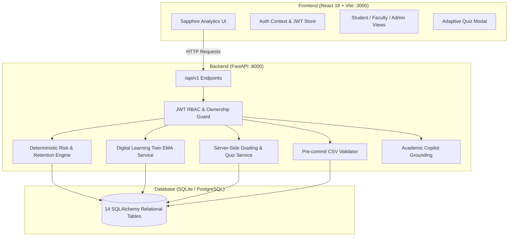

# CampusIQ — AI Student Success & Predictive Retention Platform
**HacXLerate 2026 · Challenge: KPMG in India · Team: DEBUG MASTERS**

> **An explainable AI/ML analytics and early-intervention platform for higher education institutions that converts continuous student telemetry into actionable retention insights, topic-level learning twin profiles, adaptive diagnostics, and advisor interventions.**

---

## 📋 Table of Contents
1. [Executive Summary & Problem Statement](#-executive-summary--problem-statement)
2. [Innovation & Key Features](#-innovation--key-features)
3. [Technology Stack](#-technology-stack)
4. [Architecture & System Flow](#-architecture--system-flow)
5. [Demo User Credentials](#-demo-user-credentials)
6. [Beginner-Friendly Windows PowerShell Setup & Run Guide](#-beginner-friendly-windows-powershell-setup--run-guide)
7. [Running the Automated Test Suite](#-running-the-automated-test-suite)
8. [AI Risk Engine & Scoring Methodology](#-ai-risk-engine--scoring-methodology)
9. [Digital Learning Twin & Adaptive Quizzes](#-digital-learning-twin--adaptive-quizzes)
10. [CSV Data Quality & Ingestion Engine](#-csv-data-quality--ingestion-engine)
11. [REST API Endpoints Overview](#-rest-api-endpoints-overview)
12. [Hackathon Demo Walkthrough](#-hackathon-demo-walkthrough)
13. [Limitations, Model Assumptions & Disclaimers](#-limitations-model-assumptions--disclaimers)
14. [Troubleshooting Guide](#-troubleshooting-guide)

---

## 🎯 Executive Summary & Problem Statement

### The Problem: *Lagging Indicator Syndrome*
In global higher education, an estimated **25%–30% of undergraduate students fail to complete their degree program**. Historically, academic counseling offices rely on mid-term or end-of-semester report cards—**lagging indicators** that identify failure only after it has already occurred and when remediation options are severely constrained.

### The Solution: *CampusIQ Continuous Telemetry*
CampusIQ transitions academic counseling from reactive remediation to **proactive, evidence-grounded early intervention**. By evaluating:
- Continuous attendance fluctuations and statutory threshold breaches (<75%),
- Formative assignment completion latency,
- LMS engagement and activity heatmaps,
- Granular concept mastery via an adaptive **Digital Learning Twin**,

CampusIQ calculates a deterministic, explainable risk score and synthesized rolling 7-day study plan, while equipping faculty and academic advisors with one-click intervention pathways.

---

## 💡 Innovation & Key Features

| Feature | Description | Value |
| :--- | :--- | :--- |
| **Deterministic Risk Engine** | Multivariate deficit formula ($R = 0.38\Delta_G + 0.32\Delta_A + 0.18\Delta_S + 0.12\Delta_H$) with statutory attendance breach flag. | 100% explainable; zero "black box" hallucination. |
| **Provisional Retention Sigmoid** | Logistic estimate calibrated against credit milestones and critical course enrollments. | Longitudinal graduation foresight with clear model disclaimers. |
| **Digital Learning Twin** | Topic-level concept tracker updated via exponential moving average ($\text{New} = 0.7\cdot\text{Old} + 0.3\cdot\text{Quiz}$). | Distinguishes between "not assessed" and demonstrated failure. |
| **Adaptive Diagnostic Quizzes** | Server-graded quiz items; answer keys strictly kept on backend to prevent tampering. | Immediate concept remediation with automated mastery updates. |
| **Rolling 7-Day Study Planner** | Personalized time budgeting focused on priority learning gaps. | Tracks planned vs actual minutes without fabricated completion. |
| **Faculty Intervention Suite** | Cohort risk leaderboard, attendance warning filters, and referral tracking. | Closes the loop between alert and counselor action. |
| **Admin CSV Quality Validator** | Pre-commit schema, duplicate roll number, and range validation before commit. | Guarantees transactional database consistency with audit ledger. |
| **AI Academic Copilot** | Contextual chatbot grounded in student's verified records. | Role-aware advice; fallback rule engine when external APIs are unconfigured. |

---

## 💻 Technology Stack

### Frontend
- **Framework:** React 18, TypeScript, Vite
- **Styling:** Vanilla CSS & Tailwind CSS (Custom Sapphire EdTech theme: navy, indigo, subtle teal)
- **Icons & Components:** Lucide React icons, accessible modals, responsive mobile drawer
- **Visuals:** SVG trajectory graphs, 56-day attendance matrices, interactive topic heatmaps
- **API Client:** Fetch API with automatic detection and seamless offline mock fallback

### Backend
- **Framework:** FastAPI (Python 3.10+) with Uvicorn ASGI server
- **Validation:** Pydantic v2 schemas for all requests and responses
- **Database ORM:** SQLAlchemy 2.0 with Foreign Key integrity and indexing
- **Database Engine:** SQLite (local development) / PostgreSQL-compatible configuration
- **Security:** PBKDF2-SHA256 password hashing, signed JWT Bearer authentication, server-side RBAC
- **Data Ingestion:** Pandas CSV parsing, row-level validation, and transactional commits
- **Testing:** Pytest & HTTPX automated test suites

---

## 🏛️ Architecture & System Flow



---

## 🔑 Demo User Credentials

The database comes pre-seeded with 3 realistic personas ready for login and role verification:

| Role | Email Address | Password | Permissions & Persona |
| :--- | :--- | :--- | :--- |
| **Student** | `a.rivera@campus.edu` | `Password123!` | Alex Rivera (CS Major, 3.78 GPA). Can view own telemetry, take quizzes, complete study plans, and query AI Copilot. |
| **Faculty** | `e.vance@campus.edu` | `Password123!` | Dr. Elena Vance (Advisor). Can access cohort directory, filter at-risk students, log interventions, and export CSVs. |
| **Admin** | `admin@campus.edu` | `Password123!` | University Registrar Admin. Can inspect audit logs, manage courses, preview CSV uploads, and commit imports. |

---

## 🚀 Beginner-Friendly Windows PowerShell Setup & Run Guide

Follow these exact steps in **Windows PowerShell**.

### Step 1: Open Terminal 1 — Start the Python FastAPI Backend

Open a PowerShell terminal and run:

```powershell
# 1. Navigate to the project directory
cd C:\Users\Dell\Desktop\student

# 2. (Optional) Create and activate a Python virtual environment
python -m venv venv
.\venv\Scripts\Activate.ps1

# 3. Install required Python packages
pip install -r backend/requirements.txt

# 4. Seed the database with initial accounts, courses, and quiz questions
python backend/app/db/seed.py

# 5. Start the FastAPI backend server
python backend/run.py
```

*Expected output:*
```text
INFO:     Started server process
INFO:     Waiting for application startup.
INFO:     Application startup complete.
INFO:     Uvicorn running on http://127.0.0.1:8000 (Press CTRL+C to quit)
```

> **API Documentation**: Open your browser at **`http://localhost:8000/docs`** to see the interactive Swagger UI.

---

### Step 2: Open Terminal 2 — Start the React Frontend

Open a **second** PowerShell window and run:

```powershell
# 1. Navigate to the project directory
cd C:\Users\Dell\Desktop\student

# 2. Install Node dependencies (if not already installed)
npm install

# 3. Start the Vite development server
npm run dev
```

*Expected output:*
```text
  VITE v5.x.x  ready in 350 ms

  ➜  Local:   http://localhost:3000/
  ➜  Network: use --host to expose
```

Open your browser at **`http://localhost:3000`**.  
The dashboard will load with live data from your FastAPI backend!

---

## 🧪 Running the Automated Test Suite

To verify backend logic, mathematical boundaries, and authorization guards:

In PowerShell:
```powershell
cd C:\Users\Dell\Desktop\student
pytest backend/tests/ -v
```

### Verified Test Suites:
1. `backend/tests/test_risk_engine.py`: Validates risk deficit weights, clamping (0–100), boundary scores, and attendance alerts.
2. `backend/tests/test_learning_twin.py`: Verifies topic mastery update formula ($0.7 \times \text{old} + 0.3 \times \text{quiz}$) and status band transitions.
3. `backend/tests/test_quizzes.py`: Verifies that question options are returned to the client without correct answers, and scores are accurately recorded.
4. `backend/tests/test_csv_import.py`: Tests pre-commit schema checking, invalid range rejection, and rollback functionality.
5. `backend/tests/test_auth_and_rbac.py`: Validates password hashing, JWT generation, and role protections.
6. `backend/tests/test_planner.py`: Tests 7-day rolling plan synthesis and task logging.
7. `backend/tests/test_health.py`: Validates application liveness and database connectivity.

---

## 📐 AI Risk Engine & Scoring Methodology

The deterministic risk engine computes:

$$\Delta_G = 100.0 - \text{grade\_percent}$$
$$\Delta_A = 100.0 - \text{attendance\_percent}$$
$$\Delta_S = 100.0 - \text{assignment\_completion\_percent}$$
$$\Delta_H = \min(100.0, \max(0.0, (25.0 - \text{weekly\_study\_hours}) \times 4.0))$$

$$\text{Composite Risk} = 0.38 \cdot \Delta_G + 0.32 \cdot \Delta_A + 0.18 \cdot \Delta_S + 0.12 \cdot \Delta_H$$

### Risk Bands:
- **Low Risk (0 – 29)**: Academic progress satisfies expectations.
- **Moderate Risk (30 – 54)**: Specific performance or attendance drop detected.
- **High Risk (55 – 74)**: Persistent deficits across multiple criteria; proactive counseling required.
- **Critical Risk (75 – 100)**: Immediate intervention required.

> **Statutory Attendance Override**: Any attendance below **75.0%** triggers an independent **Critical Attendance Breach Flag** due to institutional accreditation rules, regardless of exam scores.

Detailed documentation available in [`docs/score_methodology.md`](file:///c:/Users/Dell/Desktop/student/docs/score_methodology.md).

---

## 🧬 Digital Learning Twin & Adaptive Quizzes

Unlike coarse course letter grades, CampusIQ builds a **Digital Learning Twin** tracking granular topics (e.g. *Singular Value Decomposition*, *Dynamic Programming*, *SQL Indexing*):

1. **Unassessed Topics**: Marked honestly as `NOT ASSESSED` (never assumed to be zero).
2. **Moving Average Calibration**:
   $$\text{Mastery}_{\text{new}} = 0.70 \cdot \text{Mastery}_{\text{prior}} + 0.30 \cdot \text{Quiz}_{\text{percent}}$$
3. **Mastery Bands**:
   - `< 50%`: `priority learning gap` (red badge)
   - `50% – 69%`: `needs practice` (amber badge)
   - `≥ 70%`: `provisional mastery` (emerald badge)
4. **Adaptive Diagnostic Flow**: Students can click **Take Diagnostic Quiz** on any weak topic. Quiz questions are dynamically retrieved without exposing answer keys; grading occurs exclusively server-side.

---

## 📊 CSV Data Quality & Ingestion Engine

Located in the **Admin Portal**:
- **Pre-Commit Preview**: Upload CSVs and receive instant row-by-row validation feedback before database changes occur.
- **Validation Checks**:
  - Validates missing roll numbers, names, or emails.
  - Enforces CGPA range ($0.0 \le \text{CGPA} \le 4.0$).
  - Enforces attendance and grade percentages ($0.0 \le \% \le 100.0$).
  - Detects duplicate roll numbers.
- **Transactional Commit**: Only error-free rows are committed; failed uploads roll back safely without corrupting existing records.
- **Sample File Provided**: Try uploading [`data/sample_students.csv`](file:///c:/Users/Dell/Desktop/student/data/sample_students.csv), which contains 6 valid student records and 1 deliberately invalid row to demonstrate error handling.

---

## 🔌 REST API Endpoints Overview

| Category | Endpoint | Method | Role | Description |
| :--- | :--- | :--- | :--- | :--- |
| **Auth** | `/api/v1/auth/login` | POST | Public | Authenticates user and issues signed JWT |
| **Auth** | `/api/v1/auth/me` | GET | Authenticated | Returns current profile and permissions |
| **Health** | `/api/v1/health` | GET | Public | Healthcheck and active model versions |
| **Student** | `/api/v1/students/{id}` | GET | Student/Faculty/Admin | Returns student profile and bio metrics |
| **Analytics** | `/api/v1/analytics/students/{id}/risk` | GET | Student/Faculty/Admin | Returns composite risk breakdown |
| **Courses** | `/api/v1/students/{id}/courses` | GET | Student/Faculty/Admin | Returns active semester course risk matrix |
| **Twin** | `/api/v1/learning-twin/{id}` | GET | Student/Faculty/Admin | Returns topic mastery matrix |
| **Quizzes** | `/api/v1/quizzes/questions` | GET | Authenticated | Retrieves questions (answers withheld) |
| **Quizzes** | `/api/v1/quizzes/submit` | POST | Authenticated | Server verifies answers & updates twin |
| **Planner** | `/api/v1/planner/{id}` | GET | Student/Faculty/Admin | Returns rolling 7-day study schedule |
| **Planner** | `/api/v1/planner/tasks/{id}/complete` | PATCH | Student/Faculty/Admin | Records task completion and study time |
| **Faculty** | `/api/v1/faculty/cohort` | GET | Faculty/Admin | Aggregated department risk directory |
| **Faculty** | `/api/v1/faculty/interventions` | POST | Faculty/Admin | Creates advisor intervention record |
| **Admin** | `/api/v1/admin/csv-import/preview` | POST | Admin | Validates CSV upload before commit |
| **Admin** | `/api/v1/admin/csv-import/commit` | POST | Admin | Transactionally commits validated rows |
| **Admin** | `/api/v1/admin/audit-logs` | GET | Admin | Inspects security audit ledger |
| **Copilot** | `/api/v1/copilot/query` | POST | Authenticated | Answers queries grounded in student records |

Full OpenAPI specification available in [`docs/api_specification.md`](file:///c:/Users/Dell/Desktop/student/docs/api_specification.md).

---

## 🎬 Hackathon Demo Walkthrough (5-Minute Script)

See [`docs/demo_script.md`](file:///c:/Users/Dell/Desktop/student/docs/demo_script.md) for the exact minute-by-minute speaking and click-through script:
1. **Minute 0–1**: Problem Pitch & Sapphire Dashboard Overview.
2. **Minute 1–2**: Explainable Risk Engine & MA-204 Linear Algebra Diagnostic.
3. **Minute 2–3**: Digital Learning Twin & Adaptive Quiz Demonstration.
4. **Minute 3–4**: 7-Day Rolling Study Planner & Grounded AI Copilot.
5. **Minute 4–5**: Faculty Intervention Workflow & Admin CSV Quality Ingestion.

---

## ⚠️ Limitations, Model Assumptions & Disclaimers

1. **Explainable Baseline Model**: The Academic Risk Engine uses an explainable heuristic model based on university literature rather than a black-box deep learning system.
2. **Provisional Retention Probability**: Retention probability estimates are illustrative decision-support metrics, not definitive predictions of student outcomes.
3. **Synthetic Demonstration Data**: All student names, grades, and records are synthetic and generated for demonstration purposes.
4. **Privacy by Design**: Student records are strictly compartmentalized using server-side role-based authorization; students cannot access other students' records.

---

## 🔧 Troubleshooting Guide

| Issue | Cause | Solution |
| :--- | :--- | :--- |
| `Cannot connect to backend` / `Offline Demo Mode active` | FastAPI server is not running on port 8000 | Open a separate PowerShell terminal, navigate to project root, and execute `python backend/run.py`. |
| `ModuleNotFoundError: No module named 'fastapi'` | Python packages not installed in active environment | Run `pip install -r backend/requirements.txt` in your activated virtual environment. |
| `npm: command not found` | Node.js not installed on system | Install Node.js LTS (v18 or v20) from [nodejs.org](https://nodejs.org). |
| `Port 8000 already in use` | Another process is holding port 8000 | In PowerShell, run `Get-Process -Id (Get-NetTCPConnection -LocalPort 8000).OwningProcess | Stop-Process` or run backend on `--port 8001`. |
| `Database is locked` | Concurrent write lock in SQLite | Ensure old background python processes are closed before re-running `seed.py`. |

---

**Team DEBUG MASTERS · HacXLerate 2026**
